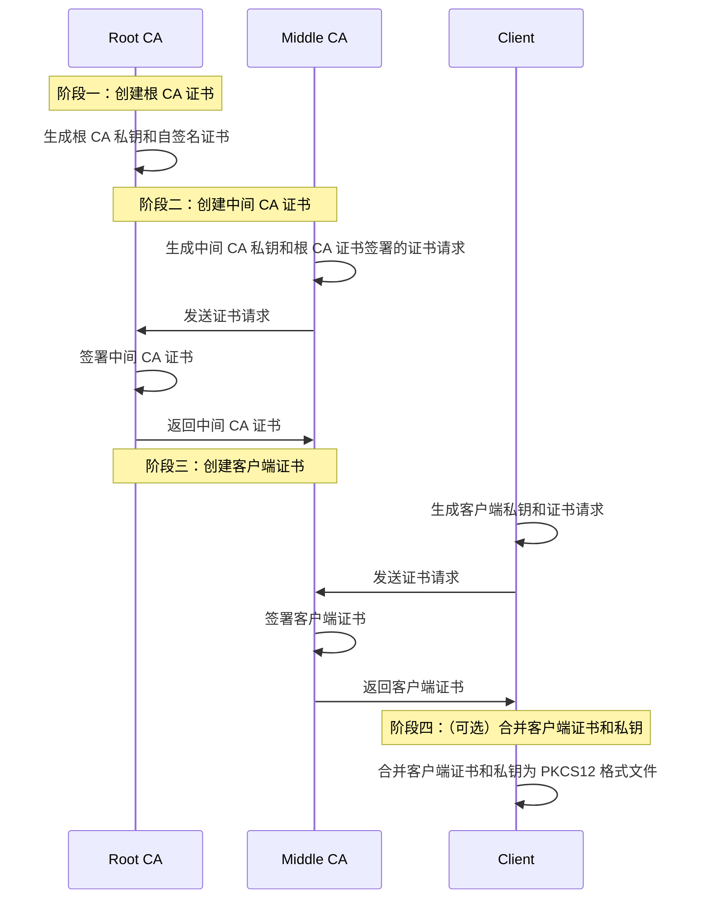

传输层安全（Transport Layer Security, TLS）基本是现代互联网的基石了，像 HTTPS 的全称就是 HTTP over TLS。TLS 中的信任体系基于 x509 证书链，通常情况下，仅服务端发送证书，并由客户端进行验证。而 mTLS (Mutual TLS) 则是客户端和服务器端都发送证书，并进行双向验证，基于 mTLS 可以实现对客户端的身份认证，并实现现代密码学级的安全性。

然而大部分公开服务都没有使用 mTLS，而是使用传统的用户名 + MFA，在这一模型中，用户名用于身份识别，而 MFA 用于验证用户的身份。mTLS 本身也可以作为 MFA 的认证手段之一，但由于其配置复杂极少用于公开服务中，同时由于应用场景少未受到广泛支持。

私有服务的安全模型相对于公开服务的一大优势就是允许系统的隔离性，邮箱、短信验证码等依赖于外部服务，这会破坏系统的私有性，而 TOTP 虽然可以做到隔离，但实际应用中通常基于第三方 APP。对于私有服务乃至个人服务，我自身作为唯一用户，完全无需考虑用户的认知负担，mTLS 反而成为最合适的认证方式之一。基于私有 CA 建立的客户端证书链则是严格限制了系统的边界，更高的私有性本身也就意味着更高的安全性。

## 证书链构建

*想法是好的，但到工程落地还是有一定的距离，在这套系统设计的过程中也包括了很多试错，因此大部分流程直接基于 openssl cli。*


虽然在一些内网服务等无公共域名的场景中也需要服务端证书的构建，但本文主要讨论客户端证书的问题。



对于一部分常用算法，openssl 给出了别名，但本文会尽量避免使用以提高通用性，有需要建议以帮助信息和文档为准。


### 确定签名算法

这一步本身还是很重要的，但通常会被忽略，在网上找到的大部分教程也是基于 RSA 算法。不得不说 RSA 算法确实经典，但其性能和安全性已经落后了，基本上直接 pass。比较主流的方案是基于椭圆曲线算法，如 ECDSA 和 Ed25519，或是拥抱未来使用更先进的 SLH-DSA 和 MLDSA 等 PQC 算法（已受 openssl 支持）。

然后这里就踩到了第一个坑，新的算法可能不受客户端/服务段软件支持，这会导致证书验证失败。例如 Firefox 就不支持 PQC 和 Ed25519 证书，导入证书会显示 "未知的签名算法"。最后还是选择了 ECDSA + P-256 签名算法。


这一限制实际上可以通过双 Nginx 代理绕过，在中间的公共网络环境下通过 Nginx 间通信使用更先进的算法，而安全环境下（客户端到代理 Nginx，反向代理 Nginx 到服务端）则可以回退到兼容性环境。


### 生成客户端证书

尽管在单用户场景下可以直接使用自签名证书，但更优雅的方式是使用私有 CA 生成证书。客户端证书和 CA 的签署流程没有区别，主要差异在于证书用途等 X509 扩展字段。

生成私钥：
```bash
# 根 CA 私钥
openssl genpkey -algorithm EC -pkeyopt ec_paramgen_curve:P-256 -outform DER -out ppq.ca.key 
# 中间 CA 私钥
openssl genpkey -algorithm EC -pkeyopt ec_paramgen_curve:P-256 -outform DER -out client.ppq.ca.key
# 客户端私钥
openssl genpkey -algorithm EC -pkeyopt ec_paramgen_curve:P-256 -outform DER -out ppqarch.key
```

openssl 的默认格式是 PEM，使用 base64 编码，个人习惯使用二进制的 DER 格式，但应注意部分软件仅支持 PEM 格式，使用时应先进行转换。


使用 `req -x509` 创建自签名证书：
```bash
openssl req -x509 -key ppq.ca.key -days 7200 -outform DER -out ppq.ca.crt -subj "/C=CN/CN=ppq.ca/O=PPQ's private service" -addext 'basicConstraints=critical,CA:TRUE' -addext 'keyUsage=critical,keyCertSign,cRLSign'
```

`CA:TRUE` 表示这是一个 CA 证书，`critical` 表示该字段必须被理解，否则应拒绝该证书，`keyCertSign` 表示该证书可用于签署其他证书，`cRLSign` 表示该证书可用于签署证书吊销列表，这两项通常配合 CA 使用。证书的签署和吊销可以分开放在不同的 CA 证书中，更符合权限最小化原则。

使用 `req -new` 创建证书请求：
```bash
openssl req -new -key client.ppq.ca.key -outform DER -out client.ppq.ca.csr -subj "/C=CN/CN=client.ppq.ca/O=PPQ's private service"
openssl req -new -key ppqarch.key -outform DER -out ppqarch.csr -subj "/C=CN/CN=ppqarch/O=PPQ's private service"
```

使用 `req -in` 签署证书请求：
```bash
openssl req -in client.ppq.ca.csr -CA ppq.ca.crt -CAkey ppq.ca.key -days 3600 -out client.ppq.ca.crt -copy_extensions copyall -addext 'basicConstraints=critical,CA:TRUE,pathlen:1' -addext 'keyUsage=critical,keyCertSign,cRLSign'
openssl req -in ppqarch.csr -CA client.ppq.ca.crt -CAkey client.ppq.ca.key -days 360 -outform DER -out ppqarch.crt -copy_extensions copyall -addext 'basicConstraints=CA:FALSE' -addext 'keyUsage=critical,digitalSignature' -addext 'extendedKeyUsage=clientAuth'
```

`pathlen:1` 表示可最多签发一层下级 CA，不提供表示无限制，`digitalSignature` 表示该证书可用于数字签名，`clientAuth` 表示该证书可用于客户端认证。


如果证书请求的提供方不被绝对信任，签署前建议先检查证书请求内容。



`extendedKeyUsage=clientAuth` 大部分主流软件都理解并支持，即使不添加 `critical` 也会进行验证（虽然我也遇到过不严格验证的软件），一般不添加 `critical` 以保持证书的兼容性。



TLS 认证基于随机挑战和数字签名，因此用于客户端和服务端认证的证书必须具有 `digitalSignature` 用途。


可选，合并客户端证书和私钥为 PKCS12 格式文件：
```bash
openssl x509 -in ppqarch.crt > ppqarch.pem
openssl pkey -in ppqarch.key >> ppqarch.pem
openssl pkcs12 -export -in ppqarch.pem -out ppqarch.p12
```

实际部署时三份私钥位于同一设备，更一般的情况参考一下流程：


## Nginx 配置 mTLS

这一部分内容实际上在 [关于最近的站点迁移](site-migration) 中已经包含了，这里再放一下相关配置。

```ini
server {
    ssl_client_certificate /etc/nginx/ssl/client.ppq.ca.chain.pem; # CA 证书链，包括根证书和中间 CA 证书
    ssl_verify_client optional; # 可选验证客户端证书
    
    location = /action/sync/blog {
        if ($ssl_client_verify != "SUCCESS") {
            return 403;
        }
        # ... Other configuration  
    }

    # ... Other configuration  
}
```

在上面的示例中允许中间 CA 签署下级 CA，这种情况下需要客户端补齐对应的下级 CA 以保证证书链完整。`ssl_verify_client optional;` 配置下，Nginx 会要求客户端提供证书并验证，但客户端为提供时不会拒绝连接，配置为 `ssl_verify_client on;` 时，客户端不提供证书则直接返回 `400`。由于部分公开服务不需要客户端认证，因此配置为可选并在 `location` 内部进行验证。

## 本地 Nginx 代理 mTLS 认证


这一步是可选的，取决于具体需求。


mTLS 在使用过程中遇到的一个问题就是客户端软件不支持，此时可以考虑在本地搭建 Nginx 代理来处理 mTLS 认证。

```ini
server {
  listen 443 ssl;
  listen [::]:443 ssl;
  server_name  localhost;

  ssl_certificate /etc/nginx/ssl/localhost.crt;
  ssl_certificate_key /etc/nginx/ssl/localhost.key;

  location = /action/sync/blog {
    proxy_pass https://service.yuime.moe/action/sync/blog;
    proxy_ssl_certificate /etc/nginx/ssl/ppqarch.pem.crt;
    proxy_ssl_certificate_key /etc/nginx/ssl/ppqarch.pem.key;
    proxy_ssl_server_name on;
  }
}
```

由于仅针对本地客户端代理，服务端证书可以使用自签名 localhost 证书。
